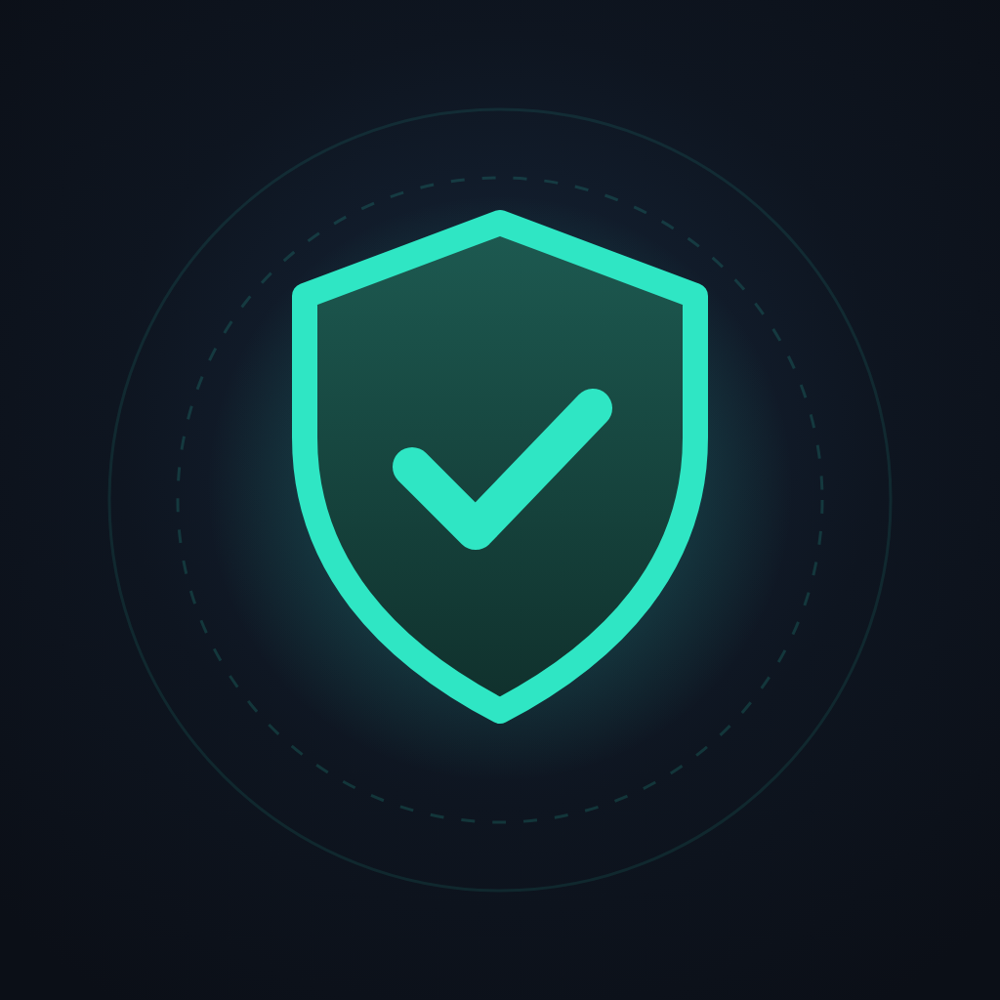

<p align="center"></p>

<h1 align="center">Периметр</h1>

<p align="center">Видно, кто и куда сливает данные с телефона.<br>
Android 10+ · без root · всё анализируется на устройстве.</p>

<p align="center">
<a href="https://wandraker.github.io/perimetr/"><b>Сайт</b></a> ·
<a href="https://github.com/Wandraker/perimetr/releases/latest/download/perimetr.apk"><b>Скачать APK</b></a> ·
<a href="https://github.com/Wandraker/perimetr/releases">Все версии</a>
</p>

---

## Что умеет

- **Монитор трафика.** Какое приложение, к какому серверу, когда и сколько раз обращалось. Блокировка сервера или всего приложения.
- **Автоблок трекеров.** Аналитика и реклама Google, Яндекса, VK, Facebook и других.
- **Прошлая ночь.** Кто и сколько отправил с 00:00 до 06:00.
- **Аудит доступов.** Все фото, файлы, камера, микрофон, геолокация, контакты, SMS.
- **Слежка за экраном.** «Специальные возможности», чтение уведомлений, окна поверх других приложений, администраторы устройства.
- **Возраст доменов.** Подсветка серверов, зарегистрированных меньше 90 дней назад.
- **Совместимость с ByeDPI.** Периметр отправляет трафик в ByeDPI, работающий в режиме прокси.

## Как устроено

Периметр поднимает локальный VPN (`VpnService`). В обычном режиме через него идут только DNS-запросы: по ним видно, какое приложение куда обращается, а заблокированные получают ответ «домен не найден». Объём трафика по приложениям берётся из системной статистики (`NetworkStatsManager`). В режиме совместимости с ByeDPI весь трафик передаётся в локальный SOCKS5-прокси через [hev-socks5-tunnel](https://github.com/heiher/hev-socks5-tunnel), а DNS идёт через DNS-over-HTTPS.

История, правила и списки приложений хранятся только на телефоне.

## Сборка

```
git clone --recurse-submodules https://github.com/Wandraker/perimetr
cd perimetr/android
gradle testReleaseUnitTest assembleRelease
```

Нужны JDK 17, Android SDK 34 и NDK 27. Без ключа подписи релизная сборка подписывается отладочным ключом.

## Лицензия

Все права защищены. Код открыт для проверки и личной сборки, распространение запрещено без разрешения. Подробно — в [LICENSE](LICENSE). Сторонние компоненты — под своими лицензиями.
